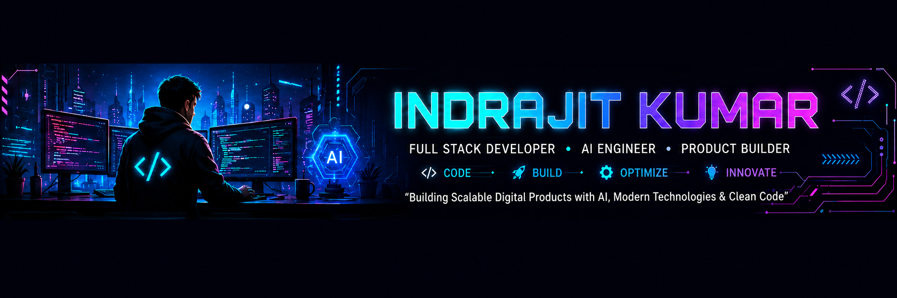




<!-- Glowing Social Badges -->















<!-- ============================================== -->
<!-- SECTION 1: ABOUT ME & PHILOSOPHY               -->
<!-- ============================================== -->
<table width="100%" style="table-layout: fixed; border-collapse: collapse; border: 1px solid #1a233a;">
<tr>
<th align="left" style="background-color: #0a0e1c; color: #00f0ff; font-family: monospace; font-size: 16px; padding: 12px 16px; border: 1px solid #1a233a;">
👤 About Me
</th>
</tr>
<tr style="background-color: #0a0e1c;">
<td valign="top" style="padding: 16px 14px; border: 1px solid #1a233a; word-wrap: break-word;">


Passionate <b>Software Engineer</b> specializing in scalable Full Stack applications, Artificial Intelligence, System Design, Cloud Technologies, and Product Development.




I enjoy transforming innovative ideas into intelligent digital products using modern technologies. I'm always eager to learn, build, and contribute to meaningful products that make a real impact.





 




</td>
</tr>
<tr style="background-color: #0d1224;">
<td valign="middle" align="center" style="padding: 14px 16px; border: 1px solid #1a233a;">

❝



Technology is not just about code, it's about creating opportunities, solving real problems and making life better for people.




— <b style="color: #00f0ff;">Indrajit Kumar</b>


</td>
</tr>
</table>







<!-- ============================================== -->
<!-- SECTION 2: TECH STACK                          -->
<!-- ============================================== -->
<table width="100%" style="table-layout: fixed; border-collapse: collapse; border: 1px solid #1a233a;">
<tr>
<th colspan="2" align="left" style="background-color: #0a0e1c; color: #00f0ff; font-family: monospace; font-size: 16px; padding: 12px 16px; border: 1px solid #1a233a;">
💠 Tech Stack
</th>
</tr>
<tr style="background-color: #0a0e1c;">
<td width="50%" valign="top" style="padding: 10px 6px; border: 1px solid #1a233a; word-wrap: break-word;">


⚡ Languages





 

 




</td>
<td width="50%" valign="top" style="padding: 10px 6px; border: 1px solid #1a233a; word-wrap: break-word;">


🎨 Frontend





 

 




</td>
</tr>
<tr style="background-color: #0a0e1c;">
<td width="50%" valign="top" style="padding: 10px 6px; border: 1px solid #1a233a; word-wrap: break-word;">


⚙️ Backend & APIs





 

 

 

 

 




</td>
<td width="50%" valign="top" style="padding: 10px 6px; border: 1px solid #1a233a; word-wrap: break-word;">


🗄️ Databases & Storage





 

 

 



</td>
</tr>
<tr style="background-color: #0a0e1c;">
<td width="50%" valign="top" style="padding: 10px 6px; border: 1px solid #1a233a; word-wrap: break-word;">


🤖 AI & Machine Learning





 

 

 

 


 




</td>
<td width="50%" valign="top" style="padding: 10px 6px; border: 1px solid #1a233a; word-wrap: break-word;">


🛠️ DevOps, Cloud & Tools





 


 

 

 

 



</td>
</tr>
</table>







<!-- ============================================== -->
<!-- SECTION 3: FEATURED PROJECTS                   -->
<!-- ============================================== -->
<table width="100%" style="table-layout: fixed; border-collapse: collapse; border: 1px solid #1a233a;">
<tr>
<th colspan="2" align="left" style="background-color: #0a0e1c; color: #00f0ff; font-family: monospace; font-size: 16px; padding: 12px 16px; border: 1px solid #1a233a;">
🚀 Featured Projects
</th>
</tr>
<tr style="background-color: #0a0e1c;">
<td width="50%" valign="top" style="padding: 12px 6px; border: 1px solid #1a233a; word-wrap: break-word;">
<b style="color: #ffffff; font-size: 14.5px;">🛒 KLYRO</b> 
E-Commerce Platform


The ultimate full-stack premium ecommerce platform. Cinematic design, multi-category hubs, and AI concierge.















</td>
<td width="50%" valign="top" style="padding: 12px 6px; border: 1px solid #1a233a; word-wrap: break-word;">
<b style="color: #ffffff; font-size: 14.5px;">🏥 PraGo</b> 
AI Medical Platform


All-in-one medical ecosystem featuring AI chat consultation, video appointments, and medicine delivery.















</td>
</tr>
<tr style="background-color: #0a0e1c;">
<td width="50%" valign="top" style="padding: 12px 6px; border: 1px solid #1a233a; word-wrap: break-word;">
<b style="color: #ffffff; font-size: 14.5px;">📈 Indra-MarketMind</b> 
Stock Sentiment Tracker


Real-time financial intelligence platform correlating live news sentiment with stock price volatility.















</td>
<td width="50%" valign="top" style="padding: 12px 6px; border: 1px solid #1a233a; word-wrap: break-word;">
<b style="color: #ffffff; font-size: 14.5px;">🧠 Indra AI</b> 
AI Workflow Automation


Personal agentic AI assistant & open-source API layer providing RAG, web search, and document analysis.















</td>
</tr>
<tr style="background-color: #0a0e1c;">
<td width="50%" valign="top" style="padding: 12px 6px; border: 1px solid #1a233a; word-wrap: break-word;">
<b style="color: #ffffff; font-size: 14.5px;">🎨 Promptly AI</b> 
AI Image Studio


Advanced web interface for generating AI images, text-to-image synthesis, and creative model pipelines.















</td>
<td width="50%" valign="top" style="padding: 12px 6px; border: 1px solid #1a233a; word-wrap: break-word;">
<b style="color: #ffffff; font-size: 14.5px;">📻 Yaadon Ki Duniya</b> 
Nostalgic Experience


Immersive web journey reviving vintage Indian nostalgia through curated retro music and ambient visuals.















</td>
</tr>
</table>







<!-- ============================================== -->
<!-- SECTION 4: MORE REPOSITORIES & CORE CODE       -->
<!-- ============================================== -->
<table width="100%" style="table-layout: fixed; border-collapse: collapse; border: 1px solid #1a233a;">
<tr>
<th colspan="2" align="left" style="background-color: #0a0e1c; color: #b026ff; font-family: monospace; font-size: 16px; padding: 12px 16px; border: 1px solid #1a233a;">
📦 Additional Repositories & Engineering Practice
</th>
</tr>
<tr style="background-color: #0a0e1c;">
<td width="50%" valign="top" style="padding: 10px 6px; border: 1px solid #1a233a; word-wrap: break-word;">
<a href="https://github.com/indrajitkumar23541-a11y/Disease-prediction" style="text-decoration: none;">
<b style="color: #00f0ff; font-size: 13.5px;">🏥 Disease-prediction</b>
</a>


Bayes' Theorem probability calculator estimating disease survival rates from medical data.



</td>
<td width="50%" valign="top" style="padding: 10px 6px; border: 1px solid #1a233a; word-wrap: break-word;">
<a href="https://github.com/indrajitkumar23541-a11y/mahalaxmi-hostel" style="text-decoration: none;">
<b style="color: #3ecf8e; font-size: 13.5px;">🏢 mahalaxmi-hostel</b>
</a>


Full-featured Hostel Management web application built with Django, role handling, and resident records.



</td>
</tr>
<tr style="background-color: #0a0e1c;">
<td width="50%" valign="top" style="padding: 10px 6px; border: 1px solid #1a233a; word-wrap: break-word;">
<a href="https://github.com/indrajitkumar23541-a11y/deepak-governance" style="text-decoration: none;">
<b style="color: #ffaa00; font-size: 13.5px;">🏛️ deepak-governance</b>
</a>


Modern public governance information and civic services tracking interface.



</td>
<td width="50%" valign="top" style="padding: 10px 6px; border: 1px solid #1a233a; word-wrap: break-word;">
<a href="https://github.com/indrajitkumar23541-a11y/DSA-In-C-" style="text-decoration: none;">
<b style="color: #00f0ff; font-size: 13.5px;">⚡ DSA-In-C-</b>
</a>


Optimized solutions, core data structures, and algorithmic problems implemented in modern C++.



</td>
</tr>
<tr style="background-color: #0a0e1c;">
<td width="50%" valign="top" style="padding: 10px 6px; border: 1px solid #1a233a; word-wrap: break-word;">
<a href="https://github.com/indrajitkumar23541-a11y/JAVA-DSA" style="text-decoration: none;">
<b style="color: #b026ff; font-size: 13.5px;">☕ JAVA-DSA</b>
</a>


Complete Java Data Structures & Algorithms practice code, trees, dynamic programming, and graphs.



</td>
<td width="50%" valign="top" style="padding: 10px 6px; border: 1px solid #1a233a; word-wrap: break-word;">
<a href="https://github.com/indrajitkumar23541-a11y/PYTHON" style="text-decoration: none;">
<b style="color: #ff4785; font-size: 13.5px;">🐍 PYTHON</b>
</a>


Python programming concepts, automation scripting modules, and foundational learning codebase.



</td>
</tr>
</table>







<!-- ============================================== -->
<!-- SECTION 5: GITHUB TELEMETRY                    -->
<!-- ============================================== -->
<table width="100%" style="table-layout: fixed; border-collapse: collapse; border: 1px solid #1a233a;">
<tr>
<th align="left" style="background-color: #0a0e1c; color: #00f0ff; font-family: monospace; font-size: 16px; padding: 12px 16px; border: 1px solid #1a233a;">
📊 GitHub Telemetry
</th>
</tr>
<tr style="background-color: #0a0e1c;">
<td align="center" style="padding: 16px 8px; border: 1px solid #1a233a;">










</td>
</tr>
</table>







<!-- ============================================== -->
<!-- SECTION 6: ACHIEVEMENTS & METRICS              -->
<!-- ============================================== -->
<table width="100%" style="table-layout: fixed; border-collapse: collapse; border: 1px solid #1a233a;">
<tr>
<th colspan="2" align="left" style="background-color: #0a0e1c; color: #b026ff; font-family: monospace; font-size: 16px; padding: 12px 16px; border: 1px solid #1a233a;">
🏆 Achievements & Coding Metrics
</th>
</tr>
<tr style="background-color: #0a0e1c;">
<td width="50%" align="center" style="padding: 12px 6px; border: 1px solid #1a233a; background-color: #0d1224;">
⚡ 
<b style="color: #ffaa00; font-size: 15px;">383+</b> 
LeetCode Solved
</td>
<td width="50%" align="center" style="padding: 12px 6px; border: 1px solid #1a233a; background-color: #0d1224;">
📜 
<b style="color: #b026ff; font-size: 15px;">SWOC 2026</b> 
Open Source Contributor
</td>
</tr>
<tr style="background-color: #0a0e1c;">
<td width="50%" align="center" style="padding: 12px 6px; border: 1px solid #1a233a; background-color: #0d1224;">
🌐 
<b style="color: #3ecf8e; font-size: 15px;">Open Source</b> 
Community Contributor
</td>
<td width="50%" align="center" style="padding: 12px 6px; border: 1px solid #1a233a; background-color: #0d1224;">
🚀 
<b style="color: #00f0ff; font-size: 15px;">Product Builder</b> 
AI & Full-Stack Apps
</td>
</tr>
<tr style="background-color: #0a0e1c;">
<td colspan="2" align="center" style="padding: 16px 8px; border: 1px solid #1a233a;">










</td>
</tr>
</table>







<!-- ============================================== -->
<!-- FOOTER                                         -->
<!-- ============================================== -->




Let's Build Something Amazing Together 🚀














<!-- Profile Views Counter -->







